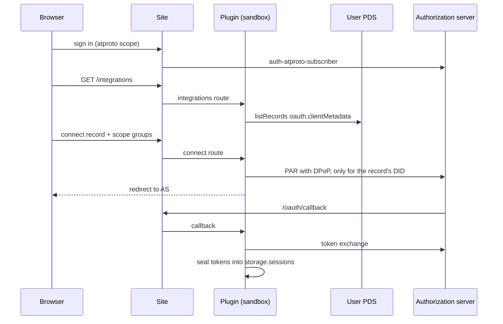
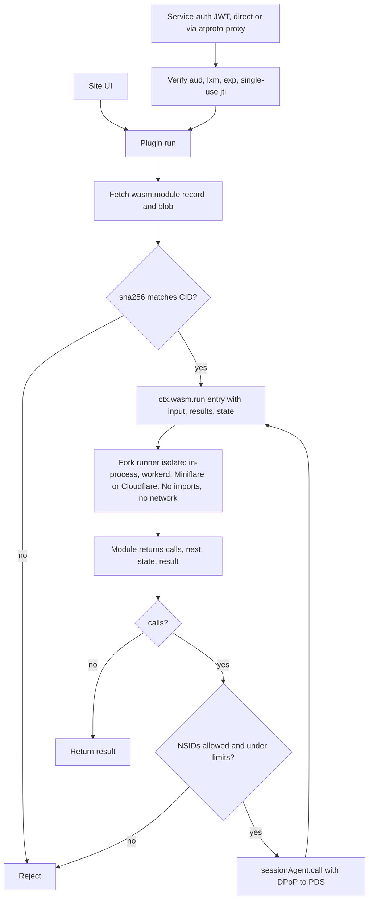
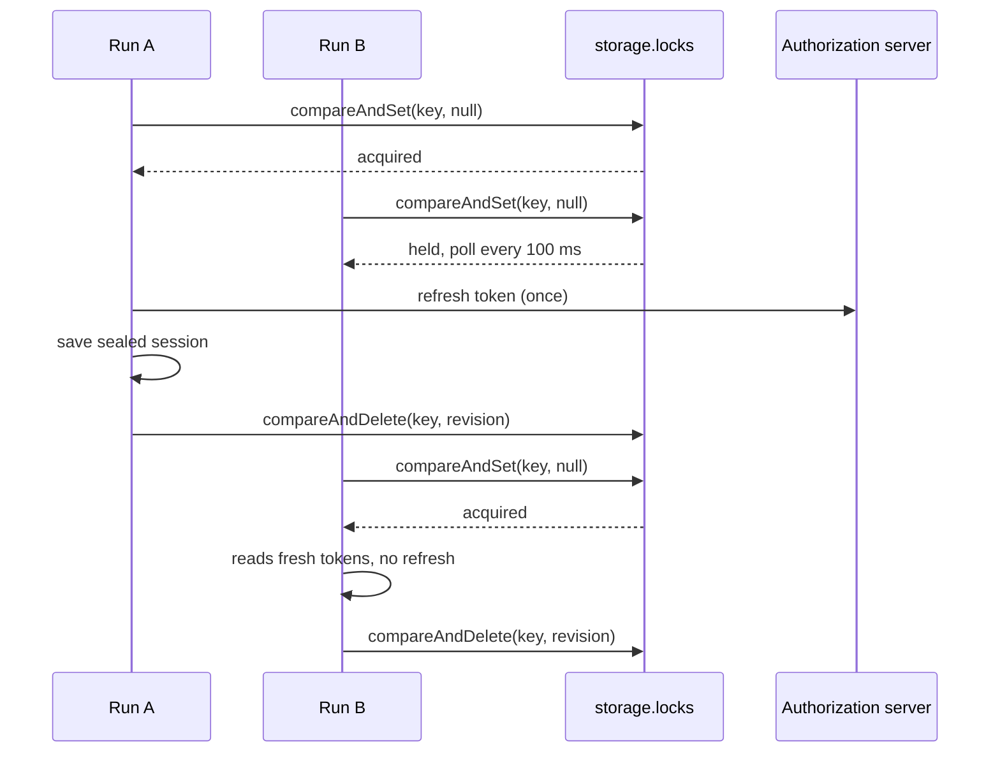

# socialweb-computer-emdash

Users sign in to an EmDash site with Atmosphere using only the `atproto` scope. On `/integrations` they can grant the site more OAuth sessions. Each integration is defined by a `com.publicdomainrelay.temp.oauth.clientMetadata` record in their own PDS.

## Run

```bash
./scripts/emdash-fork.sh
pnpm install
pnpm build
pnpm dev
```

```bash
xdg-open http://127.0.0.1:4321/integrations
```

## Atmosphere login on any EmDash site

```bash
pnpm add @publicdomainrelay/auth-atproto-subscriber
```

```js
import { atprotoSubscriber } from "@publicdomainrelay/auth-atproto-subscriber";

emdash({ authProviders: [atprotoSubscriber({ allowAnyAccount: true })] });
```

```astro
---
import AtmosphereSignIn from "@publicdomainrelay/auth-atproto-subscriber/AtmosphereSignIn.astro";
import AtmosphereSignOut from "@publicdomainrelay/auth-atproto-subscriber/AtmosphereSignOut.astro";
---
{Astro.locals.user ? <AtmosphereSignOut returnTo="/" /> : <AtmosphereSignIn returnTo="/integrations" />}
```

## Publish integration records

```bash
go install github.com/bluesky-social/goat@latest
export ATPROTO_HANDLE=alice.bsky.social ATPROTO_PASSWORD='app-password'
./scripts/publish-records.sh
```

```bash
goat lex validate -c lexicons records/statusphere.json
goat record get "at://$ATPROTO_HANDLE/com.publicdomainrelay.temp.oauth.clientMetadata/statusphere"
```

## WebAssembly integrations

```bash
./wasm/statusphere/build.sh
pnpm exec node wasm/statusphere/test.mjs
ATPROTO_PDS=https://bsky.social ./scripts/publish-wasm.sh
```

```bash
goat record get "at://$ATPROTO_HANDLE/com.publicdomainrelay.temp.wasm.module/statusphere"
```

## Run a module with atproto service auth

```bash
SITE="${SITE_URL:-https://emdash--${ATPROTO_HANDLE//./-}.fedproxy.com}"
SITE_DID="did:web:${SITE#https://}"
DOC=$(goat resolve "$ATPROTO_HANDLE")
PDS=$(jq -r '.service[] | select(.id == "#atproto_pds") | .serviceEndpoint' <<<"$DOC")
MODULE="at://$(jq -r .id <<<"$DOC")/com.publicdomainrelay.temp.wasm.module/statusphere"
ACCESS_JWT=$(curl -fsS -X POST -H 'content-type: application/json' \
  -d "{\"identifier\":\"$ATPROTO_HANDLE\",\"password\":\"$ATPROTO_PASSWORD\"}" \
  $PDS/xrpc/com.atproto.server.createSession | jq -r .accessJwt)
```

Through your PDS:

```bash
curl -fsS -X POST $PDS/xrpc/com.publicdomainrelay.temp.wasm.run \
  -H "Authorization: Bearer $ACCESS_JWT" \
  -H "atproto-proxy: $SITE_DID#emdash_integrations" \
  -H 'content-type: application/json' \
  -d "{\"module\":\"$MODULE\",\"entry\":\"set_status\",\"input\":{\"status\":\"🦋\"}}" | jq
```

With a token from `getServiceAuth`:

```bash
TOKEN=$(curl -fsS -H "Authorization: Bearer $ACCESS_JWT" \
  "$PDS/xrpc/com.atproto.server.getServiceAuth?aud=$SITE_DID&lxm=com.publicdomainrelay.temp.wasm.run" | jq -r .token)
curl -fsS -X POST "$SITE/xrpc/com.publicdomainrelay.temp.wasm.run" \
  -H "Authorization: Bearer $TOKEN" -H 'content-type: application/json' \
  -d "{\"module\":\"$MODULE\",\"entry\":\"clear_status\"}" | jq .result
```

## WebAssembly on celld

[celld/README.md](celld/README.md)

```bash
./scripts/celld.sh
```

```bash
curl -s --get http://127.0.0.1:8080/run \
  --data-urlencode did=did:plc:lpfuqerea3deuoyrn7ojser4 \
  --data-urlencode rkey=statusphere \
  --data-urlencode entry=set_status \
  --data-urlencode status=🦋 | jq .
```

```bash
./scripts/celld.sh down
```

## Public origin through fedproxy

```bash
./scripts/fedproxy.sh &
rm -f site/data.db*
EMDASH_SITE_URL="https://emdash--${ATPROTO_HANDLE//./-}.fedproxy.com" pnpm dev
```

```bash
curl -s "https://emdash--${ATPROTO_HANDLE//./-}.fedproxy.com/.well-known/atproto-client-metadata.json" | jq .scope
```

## Test

```bash
pnpm test
```

```bash
SITE_URL="https://emdash--${ATPROTO_HANDLE//./-}.fedproxy.com" pnpm exec node scripts/e2e.ts
```

## Client metadata served per record

```bash
DID=$(curl -s "https://$ATPROTO_HANDLE/.well-known/atproto-did")
curl -s "http://127.0.0.1:4321/integrations/$DID/statusphere/oauth-client-metadata.json" | jq .
```

## Add an integration

```json
{
	"$type": "com.publicdomainrelay.temp.oauth.clientMetadata",
	"name": "Example",
	"clientMetadata": {
		"client_id": "https://example.com/oauth-client-metadata.json",
		"client_uri": "https://example.com",
		"redirect_uris": ["https://example.com/oauth/callback"],
		"scope": "atproto repo:com.example.post repo:com.example.like"
	},
	"scopeGroups": [
		{ "key": "posts", "label": "Write posts", "scopes": ["repo:com.example.post"] },
		{ "key": "likes", "label": "Like posts", "scopes": ["repo:com.example.like"] }
	],
	"createdAt": "2026-11-06T00:00:00.000Z"
}
```

```bash
goat record create -n -r example example.json
```

## How it works

- **Sign-in.** Users sign in with the `atproto` scope only, through `@publicdomainrelay/auth-atproto-subscriber`.
- **Integrations.** Each `com.publicdomainrelay.temp.oauth.clientMetadata` record in the user's PDS becomes its own OAuth client. `@atcute/oauth-node-client` does PAR, PKCE, DPoP and refresh.
- **Sessions.** Sessions are AES-GCM sealed in plugin storage, one per user per integration. Only the record's own DID can authorize one.
- **Modules.** A `com.publicdomainrelay.temp.wasm.module` record points to a WebAssembly blob. The plugin checks the blob's sha256 against its CID, then runs it with `ctx.wasm.run`.
- **No ambient authority.** The module has no imports, no network and no tokens.
- **Rounds.** A module returns `{calls, next, state, result}`. The plugin makes the calls with the user's session and passes the results to `next`.
- **Limits.** 8 rounds, 10 calls per round, 25 calls in total. The record can list which NSIDs the module may call.
- **Service auth.** The site is `did:web:<host>` with service `#emdash_integrations`. `POST /xrpc/com.publicdomainrelay.temp.wasm.run` takes a service-auth JWT, which `@atcute/crypto` verifies. The plugin checks `aud`, `lxm` and `exp`, and each `jti` works only once.
- **Parallel runs.** A lease in plugin storage serializes token refresh. Parallel runs refresh a session once instead of racing single-use refresh tokens.
- **Bundle.** The plugin bundle is about 93 KB, under the registry's 128 KB per-file cap.

### Connect



### Run (rounds)



### Parallel refresh



## EmDash fork patches

All patches are on `publicdomainrelay/emdash`, branch `wasm-blob-sandbox`.

- `fcfc6960b`: the `wasm:execute` capability and a JSON ABI runner in core.
- `024d16fa8`: a runner for Node workerd and Miniflare.
- `db1525cdd`: a Cloudflare runner that runs each module in a Worker Loader isolate (`packages/cloudflare/src/sandbox/bridge-wasm.ts`).
- `dacc55fdf`: celld's CPU-limit message maps to `WASM_TIMEOUT`.
- `04769ba75`: plugin-cli bundles the `workerd`, `worker` and `browser` builds of dependencies instead of their Node builds.
- `c28373a85`: the Miniflare dev runner uses the production compatibility date and `nodejs_compat`.
- Also on the branch:
  - a spec, `proposals/sandboxed-wasm-modules.md`;
  - a lint fix;
  - a test that evaluates generated wasm sources with `node:vm`.

## Cloudflare Workers

The code path exists, but the site has never been deployed to Cloudflare itself.

- **Runner.** The Cloudflare runner uses a Worker Loader (Dynamic Workers) isolate with `globalOutbound: null`.
- **Tested so far:**
  - the Cloudflare runner's unit tests;
  - celld, which emulates Dynamic Workers locally, running module rounds;
  - the full live flow on the Miniflare dev runner.
- **A deploy needs:**
  - this fork's packages, because upstream EmDash has no `wasm:execute`;
  - a Worker Loader binding on the account;
  - D1 for plugin storage, whose `compareAndSet` backs the refresh lock and replay protection;
  - compatibility date `2025-01-01` or later, with `nodejs_compat`;
  - the PDS and authorization server hosts allowed for `ctx.http`.
- **Module network access.** Modules need no network access. Every call goes through the plugin's `ctx.http`.

## What is ours

Legend: `●` ours, `◐` upstream code we patched, `○` third-party and untouched.

```text
socialweb-computer-emdash/                    ● github.com/publicdomainrelay/socialweb-computer-emdash
├── site/                                     ● Astro + EmDash site
│   ├── astro.config.mjs                      ● plugin, login provider, sandbox runner
│   ├── seed/seed.json                        ● title, menu
│   └── src/
│       ├── layouts/Base.astro                ●
│       ├── styles/site.css                   ●
│       ├── utils/integrations.ts             ● calls plugin routes
│       └── pages/
│           ├── index.astro                   ● landing page
│           ├── integrations/index.astro      ● connect, run, rounds UI
│           ├── integrations/[did]/[rkey]/oauth-client-metadata.json.ts  ● client metadata per record
│           ├── .well-known/did.json.ts       ● did:web document with #emdash_integrations
│           └── xrpc/com.publicdomainrelay.temp.wasm.run.ts  ● Bearer token to plugin service/run
├── plugins/atproto-integrations-emdash/      ● sandboxed plugin
│   ├── emdash-plugin.jsonc                   ● capabilities; storage clients, pending, sessions, replays, locks
│   ├── src/
│   │   ├── plugin.ts                         ● routes
│   │   ├── flow.ts                           ● list, connect, callback, disconnect, sessionAgent
│   │   ├── oauth.ts                          ● OAuthClient and sealed stores
│   │   ├── lock.ts                           ● storage lease for token refresh
│   │   ├── modules.ts                        ● blob fetch, CID check, rounds loop
│   │   ├── service-auth.ts                   ● JWT verify, jti replay, did:web
│   │   ├── identity.ts                       ● resolver wiring
│   │   ├── http.ts                           ● ctx.http as fetch
│   │   └── record.ts scopes.ts seal.ts       ● record parsing, scope groups, AES-GCM
│   └── tests/                                ● sandbox tests
├── wasm/statusphere/                         ● Rust module: set_status, clear_status
├── lexicons/com/publicdomainrelay/temp/      ● oauth.clientMetadata, wasm.module, wasm.run
├── records/                                  ● example records
├── celld/                                    ● celld Worker using the fork runtime
├── scripts/                                  ● e2e.ts, celld.sh, fedproxy.sh, publish-*.sh, emdash-fork.sh
├── docs/adrs/                                ● decisions
└── emdash/ (submodule)                       ◐ github.com/publicdomainrelay/emdash @ wasm-blob-sandbox
    ├── proposals/sandboxed-wasm-modules.md   ● spec
    └── packages/
        ├── core/src/plugins/wasm.ts          ● JSON ABI runner
        ├── core/src/plugins/{context,types,index,manifest-schema}.ts  ◐ ctx.wasm, capability
        ├── plugin-types/src/                 ◐ wasm:execute in manifest and descriptions
        ├── plugin-cli/src/build/pipeline.ts  ◐ worker export conditions
        ├── plugin-cli/src/manifest/schema.ts ◐
        ├── workerd/src/sandbox/wasm-executor.ts   ● Node workerd runner
        ├── workerd/src/sandbox/compatibility.ts   ● shared compatibility date and flags
        ├── workerd/src/sandbox/{bridge-handler,wrapper,capnp,dev-runner}.ts  ◐
        ├── cloudflare/src/sandbox/bridge-wasm.ts  ● Worker Loader isolate runner
        ├── cloudflare/src/sandbox/{bridge,wrapper,types}.ts  ◐
        ├── admin/src/lib/api/marketplace.ts  ◐ capability label
        ├── plugins/marketplace-test/         ◐ fixture
        └── everything else                   ○ upstream

external
├── @publicdomainrelay/auth-atproto-subscriber   ● separate repo, installed from npm
├── @atcute/oauth-node-client, identity-resolver, identity, crypto, lexicons   ○
├── @scure/base, @noble/curves (tests only)      ○
├── astro, the rest of emdash                    ○
└── celld, rustfs, goat, fedproxy                ○ tooling
```

- Generated, not hand-written: `pnpm-lock.yaml` and `wasm/statusphere/Cargo.lock`.
- Count our own tracked lines:

```bash
git ls-files | grep -v -E '\.(md|wasm|lock)$|pnpm-lock\.yaml|^emdash$' | xargs cat | wc -l
```
