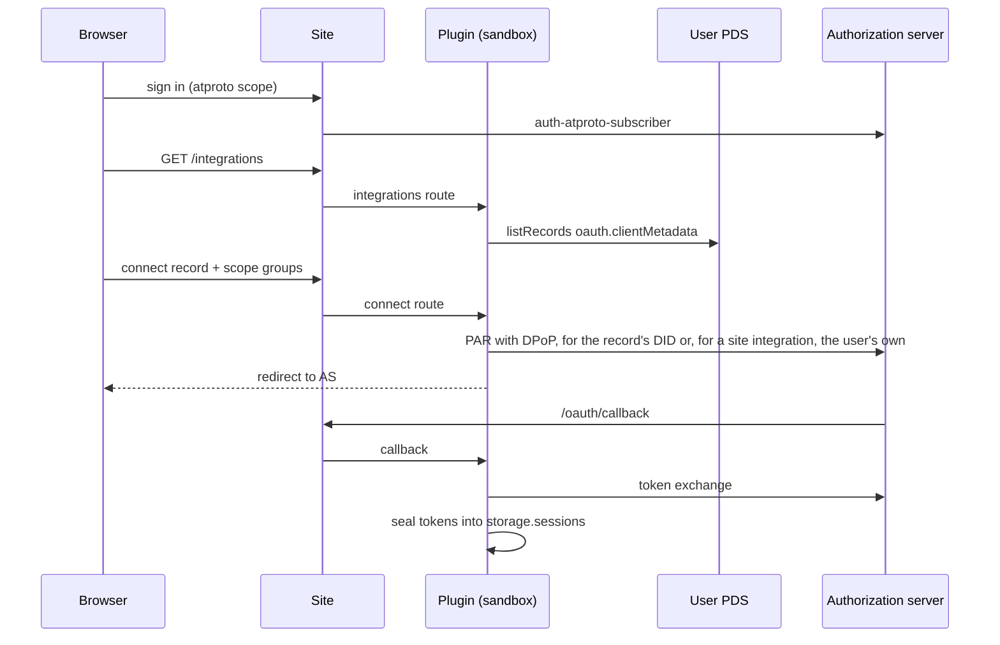
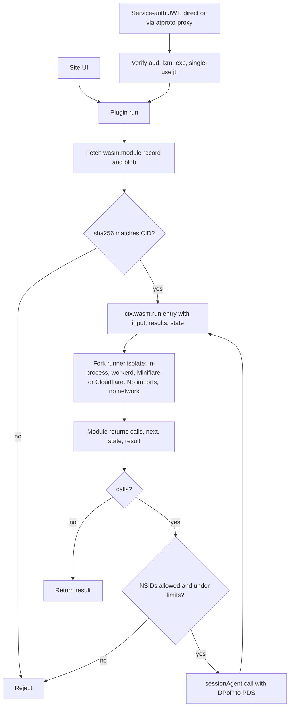
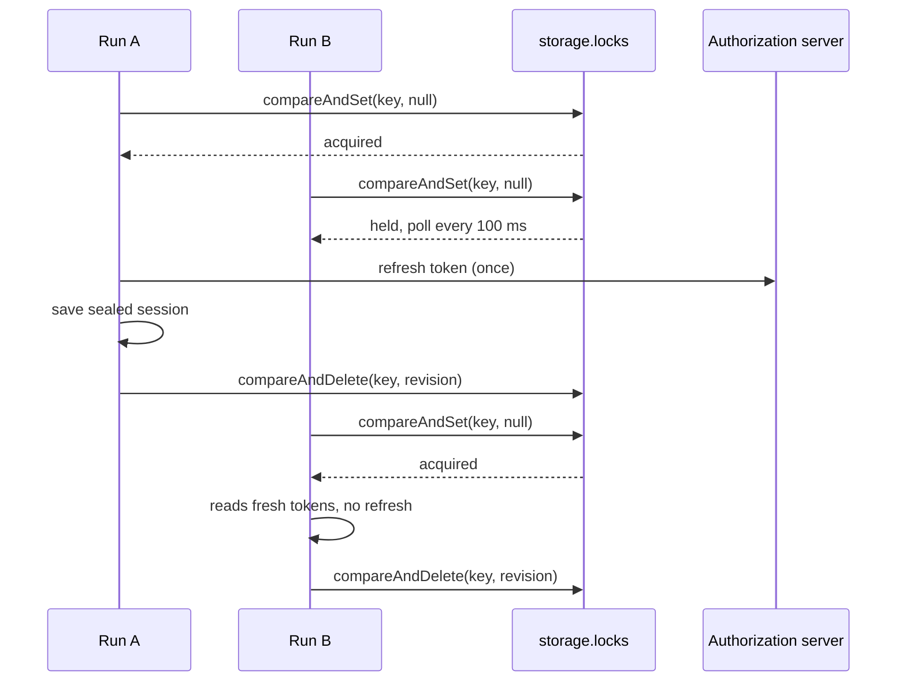

# socialweb-computer-emdash

Users sign in to an EmDash site with Atmosphere using only the `atproto` scope. On `/integrations` they can grant the site more OAuth sessions. Each integration is defined by a `com.fedfork.exec.oauth.clientMetadata` record in their own PDS. On `/studio` they can write those records, compile AssemblyScript modules in the browser, and publish them with their source.

Our lexicons are `com.fedfork.exec.*`: `oauth.clientMetadata`, `wasm.module`, `wasm.run`, `source.file` and `source.manifest`. Each is described in [docs/lexicons.md](docs/lexicons.md) and at [/lexicons](https://exec.fedfork.com/lexicons).

## The pattern: one session per set of scopes

- **Login is identity only.** Signing in asks for `atproto` and never grows.
- **Every extra capability is a new OAuth session.** Each is defined by an `oauth.clientMetadata` record and granted one scope group at a time, when the user asks for it. Sessions are sealed per user per record.
- **Integrations come from two places:**
  - **The user's own records.** Only that account can authorize them, so a third party cannot use this site's client identity to ask someone for scopes.
  - **Site integrations.** These are records the operator vouches for by listing their AT-URIs, one per line, in the plugin setting `siteIntegrations`. The plugin reads the list from its own settings. Any signed-in account may authorize a site integration, for itself only.
- **The studio is just another record.** It is the site integration with record key `studio`, defined in `records/studio.json`, with the groups `integrations` and `modules`.
  - On this site it is published by the operator account, currently the test account `did:plc:lpfuqerea3deuoyrn7ojser4`.
  - Publishing always writes to the account the studio session belongs to.
- **Modules only run with own-record sessions.** A module's `session` must name an integration record in the module's own repo, so a site integration session such as the studio cannot drive a module.
- **Configuration.** An admin sets `siteIntegrations` in EmDash admin → Plugins → atproto integrations → Settings → Site integrations, or with the plugin route `admin/site-integrations` (`POST`, needs `plugins:manage`; `{"integrations": [...]}` sets the list, `{}` reads it). It keeps only valid `com.fedfork.exec.oauth.clientMetadata` URIs.
  - A fresh deploy, including one from the Deploy button, offers no site integrations and so no studio until an admin sets it.
  - The quickest start is to list this site's studio record, `at://did:plc:lpfuqerea3deuoyrn7ojser4/com.fedfork.exec.oauth.clientMetadata/studio`. To own it, publish your own `records/studio.json` and list that instead.
  - On exec.fedfork.com the admin is the operator account, and `scripts/e2e.ts` sets the list to that account's studio record.

Live on Cloudflare Workers: https://exec.fedfork.com. The site itself is the guide: [how it works](https://exec.fedfork.com/how-it-works), [use it](https://exec.fedfork.com/use), [write a module](https://exec.fedfork.com/modules), [lexicons](https://exec.fedfork.com/lexicons) and [deploy your own](https://exec.fedfork.com/deploy). New accounts can [add the examples](https://exec.fedfork.com/studio/examples) in one click.

To work on it, see [CONTRIBUTING.md](CONTRIBUTING.md).

[](https://deploy.workers.cloudflare.com/?url=https://github.com/publicdomainrelay/socialweb-computer-emdash)

## Run

```bash
pnpm install
pnpm build
pnpm dev
```

```bash
xdg-open http://127.0.0.1:4321/integrations
```

## Atmosphere login on any EmDash site

```bash
pnpm add @publicdomainrelay/auth-atproto-subscriber
```

```js
import { atprotoSubscriber } from "@publicdomainrelay/auth-atproto-subscriber";

emdash({ authProviders: [atprotoSubscriber({ allowAnyAccount: true })] });
```

```astro
---
import AtmosphereSignIn from "@publicdomainrelay/auth-atproto-subscriber/AtmosphereSignIn.astro";
import AtmosphereSignOut from "@publicdomainrelay/auth-atproto-subscriber/AtmosphereSignOut.astro";
---
{Astro.locals.user ? <AtmosphereSignOut returnTo="/" /> : <AtmosphereSignIn returnTo="/integrations" />}
```

## Publish integration records

```bash
GOTOOLCHAIN=auto go install github.com/bluesky-social/goat@latest
export ATPROTO_HANDLE=alice.bsky.social ATPROTO_PASSWORD='app-password'
./scripts/publish-records.sh
```

```bash
goat lex validate -c lexicons records/statusphere.json
goat record get "at://$ATPROTO_HANDLE/com.fedfork.exec.oauth.clientMetadata/statusphere"
```

## WebAssembly integrations

```bash
./wasm/build.sh
node --test wasm/*/test.mjs
./scripts/publish-wasm.sh statusphere
./scripts/publish-wasm.sh vibescrobble
```

```bash
goat record get "at://$ATPROTO_HANDLE/com.fedfork.exec.wasm.module/vibescrobble"
```

- **Build.** `wasm/build.sh` builds every module with `rustc 1.97.0`. It sets `RUSTFLAGS` to remap `$CARGO_HOME` to `/cargo` and the workspace to `/wasm`, so the same sources give the same bytes in any directory or container. Cargo's `trim-paths` would do this, but it is not stable in Cargo 1.97.
- **Publish with source.** `publish-wasm.sh` writes three kinds of record:
  - a `com.fedfork.exec.source.file` for each source file not stored yet, keyed by the sha256 of its contents;
  - a new immutable `com.fedfork.exec.source.manifest`, with the paths, `rustc --version`, the command `./build.sh`, the artifact, the output hash and the git commit;
  - the `wasm.module` record, whose `source` points at that manifest.
- **Verify.** `verify-source.sh` rebuilds a module from its PDS records alone, in Podman or Docker, never on the host, because the build command comes from a record. It compares the result with the manifest and with the published blob.

```bash
./scripts/verify-source.sh aliceoa.bsky.social vibescrobble
```

```json
{
  "built": "facaba4110ec5a77738955d45d3a2ed79e795f2ceedce5cb5643973045bc3e0a",
  "manifest": "facaba4110ec5a77738955d45d3a2ed79e795f2ceedce5cb5643973045bc3e0a",
  "published": "facaba4110ec5a77738955d45d3a2ed79e795f2ceedce5cb5643973045bc3e0a",
  "reproducible": true
}
```

- **Read it.** `/source?uri=<module or manifest at-uri>` shows the files and the build, and checks each file against its CID and sha256. Example: https://exec.fedfork.com/source?uri=at://did:plc:lpfuqerea3deuoyrn7ojser4/com.fedfork.exec.wasm.module/vibescrobble
- `statusphere`: set or clear your `xyz.statusphere.status`.
- `vibescrobble`: post a `com.vibescrobble.scrobble` record of work you shipped. The text must start with an emoji.
- **Add a module:**
  1. Add a crate under `wasm/` that uses `abi::entries!`.
  2. Add a `module.json` and a `test.mjs`.
  3. Add the module's name to `wasm/build.sh`.

## Studio

- **`/studio`.** Connect the studio, the site integration `records/studio.json`. Its groups are `integrations` (`repo:com.fedfork.exec.oauth.clientMetadata`) and `modules` (`repo:` on `wasm.module`, `source.file` and `source.manifest`, plus `blob:application/wasm`). It also appears as a card on `/integrations`, offered by this site.
- **`/studio/integration`.** A form builder for `oauth.clientMetadata` records, with scope groups and a scope helper.
- **`/studio/module`.**
  - Write AssemblyScript against the `abi.ts` helpers, then compile it in the browser with `asc` 0.28.20.
  - Run its entries locally.
  - Publish the module, its source files and its manifest.
  - The manifest's command, `npx --yes --package=assemblyscript@0.28.20 asc module.ts …`, produces the same bytes as the browser.
- **`/studio/examples`.** One click adds Statusphere and Vibescrobble to the signed-in account: integration records, modules and Rust source. It connects the studio first when needed, and skips records the account already has.
  - The bundle is `/studio/examples.json`, prerendered from `records/`, `wasm/*/module.json`, the built `.wasm` files and the sources listed in `records/wasm/<module>.manifest.json`.
  - The build fails if a source file or module no longer matches its manifest, so republish with `publish-wasm.sh` after changing a module.
  - Login alone cannot publish them: it asks only for `atproto`, and writing to an account needs that account's consent to the studio's groups.
- **Plugin routes:** `studio/status`, `studio/connect`, `studio/disconnect`, `studio/publish-integration` and `studio/publish-module`.

## Run a module with atproto service auth

```bash
SITE="${SITE_URL:-https://emdash--${ATPROTO_HANDLE//./-}.fedproxy.com}"
SITE_DID="did:web:${SITE#https://}"
DOC=$(goat resolve "$ATPROTO_HANDLE")
PDS=$(jq -r '.service[] | select(.id == "#atproto_pds") | .serviceEndpoint' <<<"$DOC")
MODULE="at://$(jq -r .id <<<"$DOC")/com.fedfork.exec.wasm.module/statusphere"
ACCESS_JWT=$(curl -fsS -X POST -H 'content-type: application/json' \
  -d "{\"identifier\":\"$ATPROTO_HANDLE\",\"password\":\"$ATPROTO_PASSWORD\"}" \
  $PDS/xrpc/com.atproto.server.createSession | jq -r .accessJwt)
```

Through your PDS:

```bash
curl -fsS -X POST $PDS/xrpc/com.fedfork.exec.wasm.run \
  -H "Authorization: Bearer $ACCESS_JWT" \
  -H "atproto-proxy: $SITE_DID#emdash_integrations" \
  -H 'content-type: application/json' \
  -d "{\"module\":\"$MODULE\",\"entry\":\"set_status\",\"input\":{\"status\":\"🦋\"}}" | jq
```

With a token from `getServiceAuth`:

```bash
TOKEN=$(curl -fsS -H "Authorization: Bearer $ACCESS_JWT" \
  "$PDS/xrpc/com.atproto.server.getServiceAuth?aud=$SITE_DID&lxm=com.fedfork.exec.wasm.run" | jq -r .token)
curl -fsS -X POST "$SITE/xrpc/com.fedfork.exec.wasm.run" \
  -H "Authorization: Bearer $TOKEN" -H 'content-type: application/json' \
  -d "{\"module\":\"$MODULE\",\"entry\":\"clear_status\"}" | jq .result
```

## WebAssembly on celld

[celld/README.md](celld/README.md)

```bash
./scripts/celld.sh
```

```bash
curl -s --get http://127.0.0.1:8080/run \
  --data-urlencode did=did:plc:lpfuqerea3deuoyrn7ojser4 \
  --data-urlencode rkey=statusphere \
  --data-urlencode entry=set_status \
  --data-urlencode status=🦋 | jq .
```

```bash
./scripts/celld.sh down
```

## Deploy to Cloudflare Workers

Needs the Workers Paid plan, for Worker Loader.

- **Button.** The Deploy to Cloudflare button copies this repo into your GitHub. Cloudflare then creates D1, R2 and KV from `wrangler.jsonc`, asks for `EMDASH_ENCRYPTION_KEY`, and runs `pnpm run build` and `pnpm run deploy`.
- **Terminal.** `pnpm run deploy` builds the plugin and the site, then runs `wrangler deploy`. Wrangler creates every D1, R2 and KV binding that has no ID, named after the Worker, and reuses them on later deploys.
- **Encryption key.** `EMDASH_ENCRYPTION_KEY` is required. Without it, connecting an integration fails with `Plugin secret settings require EMDASH_ENCRYPTION_KEY`.

```bash
pnpm install
pnpm run deploy
cd site
echo emdash_enc_v1_$(openssl rand 32 | base64 | tr '+/' '-_' | tr -d '=') | pnpm exec wrangler secret put EMDASH_ENCRYPTION_KEY --config dist/server/wrangler.json
```

- `wrangler.jsonc` is at the repo root, where the button looks for it. `site/astro.config.mjs` points the adapter at it.
- The top level has no resource IDs and no domain, so a deploy into any account gets its own resources.
- This site's own deploy is `env.fedfork`. It pins the domain `exec.fedfork.com`, `EMDASH_SITE_URL` and the existing D1, R2 and KV IDs.
- Deploy this site with `pnpm run deploy:fedfork`, not `pnpm run deploy`. The plain deploy uses the same Worker name and would rebind it to new resources.

```bash
. ~/.cloudflare_source
pnpm run deploy:fedfork
E2E_ATPROTO_HANDLE=… E2E_ATPROTO_PASSWORD=… SITE_URL=https://exec.fedfork.com pnpm exec node scripts/e2e.ts
```

## EmDash fork packages

- `pnpm install` takes the fork's packages from a GitHub release of this repo, `emdash-fork-<commit>`. The `emdash` submodule is only needed to change the fork.
- `pnpm-workspace.yaml` overrides `emdash` and `@emdash-cms/*` with the release tarball URLs. The lockfile pins each tarball's integrity hash.
- `blockExoticSubdeps` is off, because pnpm counts these URL overrides as exotic subdependencies.

After changing the fork:

```bash
./scripts/release-emdash-fork.sh
```

The script packs the fork with `scripts/emdash-fork.sh`, uploads a release for the submodule's commit, points the overrides at it and reinstalls. The full process is in [docs/emdash-fork.md](docs/emdash-fork.md).

## Public origin through fedproxy

```bash
./scripts/fedproxy.sh &
rm -f site/data.db*
EMDASH_SITE_URL="https://emdash--${ATPROTO_HANDLE//./-}.fedproxy.com" pnpm dev
```

```bash
curl -s "https://emdash--${ATPROTO_HANDLE//./-}.fedproxy.com/.well-known/atproto-client-metadata.json" | jq .scope
```

## Test

```bash
pnpm test
```

```bash
E2E_ATPROTO_HANDLE=… E2E_ATPROTO_PASSWORD=… SITE_URL="https://emdash--${ATPROTO_HANDLE//./-}.fedproxy.com" pnpm exec node scripts/e2e.ts
```

## Client metadata served per record

```bash
DID=$(curl -s "https://$ATPROTO_HANDLE/.well-known/atproto-did")
curl -s "http://127.0.0.1:4321/integrations/$DID/statusphere/oauth-client-metadata.json" | jq .
```

## Add an integration

```json
{
	"$type": "com.fedfork.exec.oauth.clientMetadata",
	"name": "Example",
	"clientMetadata": {
		"client_id": "https://example.com/oauth-client-metadata.json",
		"client_uri": "https://example.com",
		"redirect_uris": ["https://example.com/oauth/callback"],
		"scope": "atproto repo:com.example.post repo:com.example.like"
	},
	"scopeGroups": [
		{ "key": "posts", "label": "Write posts", "scopes": ["repo:com.example.post"] },
		{ "key": "likes", "label": "Like posts", "scopes": ["repo:com.example.like"] }
	],
	"createdAt": "2026-11-06T00:00:00.000Z"
}
```

```bash
goat record create -n -r example example.json
```

## How it works

- **Sign-in.** Users sign in with the `atproto` scope only, through `@publicdomainrelay/auth-atproto-subscriber`.
- **Integrations.** Each `com.fedfork.exec.oauth.clientMetadata` record in the user's PDS becomes its own OAuth client. `@atcute/oauth-node-client` does PAR, PKCE, DPoP and refresh.
- **Sessions.** Sessions are AES-GCM sealed in plugin storage, one per user per integration, and remember the account they authorize. A user's own record can only be authorized by that record's DID; a site integration can be authorized by any signed-in account, for itself.
- **Modules.** A `com.fedfork.exec.wasm.module` record points to a WebAssembly blob. The plugin checks the blob's sha256 against its CID, then runs it with `ctx.wasm.run`.
- **No ambient authority.** The module has no imports, no network and no tokens.
- **Rounds.** A module returns `{calls, next, state, result}`. The plugin makes the calls with the user's session and passes the results to `next`.
- **Limits.** 8 rounds, 10 calls per round, 25 calls in total. The record can list which NSIDs the module may call.
- **Service auth.** The site is `did:web:<host>` with service `#emdash_integrations`. `POST /xrpc/com.fedfork.exec.wasm.run` takes a service-auth JWT, which `@atcute/crypto` verifies. The plugin checks `aud`, `lxm` and `exp`, and each `jti` works only once.
- **Parallel runs.** A lease in plugin storage serializes token refresh. Parallel runs refresh a session once instead of racing single-use refresh tokens.
- **Scrobbles.** The `vibescrobble` module posts `com.vibescrobble.scrobble` records, matching atirc's emoji rule and record shape.
- **Source.** A module can point at an immutable `source.manifest` whose `source.file` records are keyed by sha256, modeled on how knotless stores repositories. Anyone can rebuild it and compare hashes.
- **Studio.** The studio is a site integration record like any other. Its session writes integration, module and source records, so the login never asks for more than `atproto`.
- **Bundle.** The plugin bundle is about 102 KB, under the registry's 128 KB per-file cap.

### Connect



### Run (rounds)



### Parallel refresh



## EmDash fork patches

All patches are on `publicdomainrelay/emdash`, branch `wasm-blob-sandbox`.

- `fcfc6960b`: the `wasm:execute` capability and a JSON ABI runner in core.
- `024d16fa8`: a runner for Node workerd and Miniflare.
- `db1525cdd`: a Cloudflare runner that runs each module in a Worker Loader isolate (`packages/cloudflare/src/sandbox/bridge-wasm.ts`).
- `dacc55fdf`: celld's CPU-limit message maps to `WASM_TIMEOUT`.
- `04769ba75`: plugin-cli bundles the `workerd`, `worker` and `browser` builds of dependencies instead of their Node builds.
- `c28373a85`: the Miniflare dev runner uses the production compatibility date and `nodejs_compat`.
- `15473214e`: the `sandboxLimits` option on `emdash()`. Without it, the Cloudflare runner's limit of 10 subrequests per invocation breaks OAuth connect.
- Also on the branch:
  - a spec, `proposals/sandboxed-wasm-modules.md`;
  - a lint fix;
  - a test that evaluates generated wasm sources with `node:vm`.

## Cloudflare Workers

Deployed and verified at https://exec.fedfork.com (ADR 0022).

- **Isolates.**
  - Sandboxed plugins run in Worker Loader isolates.
  - Each WebAssembly run gets its own isolate with `globalOutbound: null`.
  - Modules have no network access. Every call goes through the plugin's `ctx.http`.
- **Bindings:** D1 `DB` (plugin storage, refresh lock, replay protection), R2 `MEDIA`, Worker Loader `LOADER`, KV `SESSION`.
- **Limits.** `sandboxLimits: { cpuMs: 1000, subrequests: 200 }`. The runner defaults are 50 ms and 10 subrequests, which are too small for OAuth.
- **Upstream gap.** Upstream EmDash has no `wasm:execute`, so the deploy uses this fork's packages.
- **Verified with `scripts/e2e.ts`:**
  - sign-in and progressive scopes;
  - rounds and parallel runs;
  - service auth, replay refusal and the PDS proxy;
  - scrobbles;
  - the studio and the examples, installed from scratch after the run deletes them;
  - a module compiled from AssemblyScript, published with its source and run.

## What is ours

Legend: `●` ours, `◐` upstream code we patched, `○` third-party and untouched.

```text
socialweb-computer-emdash/                    ● github.com/publicdomainrelay/socialweb-computer-emdash
├── wrangler.jsonc                            ● Worker, auto-provisioned D1, R2, KV, LOADER; env.fedfork
├── .dev.vars.example                         ● secret the deploy button asks for
├── package.json                              ● build, deploy, deploy:fedfork; binding descriptions
├── site/                                     ● Astro + EmDash site
│   ├── astro.config.mjs                      ● Node or Cloudflare (EMDASH_TARGET), plugin, login, sandbox limits
│   ├── seed/seed.json                        ● title, menu
│   └── src/
│       ├── worker.ts                         ● Cloudflare entry, exports PluginBridge
│       ├── layouts/Base.astro Guide.astro    ● shell titled with the site's host, guide pages with contents and pager
│       ├── components/                       ● Diagram (Pele), Legend, Code with copy, ThemeToggle, SourceLink, StudioSession
│       ├── diagrams.ts                       ● every Mermaid diagram and its color classes
│       ├── guides.ts deploy.ts               ● guide list, deploy button URL
│       ├── lexicons.ts                       ● lexicon reference built from lexicons/ at build time
│       ├── studio/                           ● compile.ts (asc in the browser), editor, integration builder, examples bundle and installer, assemblyscript/ abi and templates
│       ├── styles/site.css                   ●
│       ├── utils/integrations.ts             ● calls plugin routes
│       ├── utils/atproto.ts utils/studio.ts  ● public record reads, studio page context
│       └── pages/
│           ├── index.astro                   ● overview
│           ├── how-it-works.astro use.astro modules.astro deploy.astro  ● guides
│           ├── lexicons/index.astro          ● lexicon reference
│           ├── studio/                       ● studio, integration builder, module editor, examples and examples.json
│           ├── source.astro                  ● source viewer and in-browser rebuild
│           ├── integrations/index.astro      ● connect, run, rounds UI
│           ├── integrations/[did]/[rkey]/oauth-client-metadata.json.ts  ● client metadata per record
│           ├── .well-known/did.json.ts       ● did:web document with #emdash_integrations
│           └── xrpc/com.fedfork.exec.wasm.run.ts  ● Bearer token to plugin service/run
├── plugins/atproto-integrations-emdash/      ● sandboxed plugin
│   ├── emdash-plugin.jsonc                   ● capabilities; storage clients, pending, sessions, replays, locks; siteIntegrations setting
│   ├── src/
│   │   ├── plugin.ts                         ● routes
│   │   ├── flow.ts                           ● list, connect, callback, disconnect, sessionAgent
│   │   ├── oauth.ts                          ● OAuthClient and sealed stores
│   │   ├── lock.ts                           ● storage lease for token refresh
│   │   ├── modules.ts                        ● blob fetch, CID check, rounds loop
│   │   ├── service-auth.ts                   ● JWT verify, jti replay, did:web
│   │   ├── site.ts                           ● site integrations from the siteIntegrations setting
│   │   ├── studio.ts                         ● studio as the site integration "studio"; publish integration, module, source
│   │   ├── identity.ts                       ● resolver wiring
│   │   ├── http.ts                           ● ctx.http as fetch
│   │   └── record.ts scopes.ts seal.ts       ● record parsing, scope groups, AES-GCM
│   └── tests/                                ● sandbox tests
├── wasm/                                     ● Cargo workspace, build.sh, harness.mjs
│   ├── abi/                                  ● shared JSON ABI: Did, CallResult, entries!
│   ├── statusphere/                          ● set_status, clear_status
│   └── vibescrobble/                         ● scrobble
├── lexicons/com/fedfork/exec/                ● oauth.clientMetadata, wasm.module, wasm.run, source.file, source.manifest
├── records/                                  ● statusphere, vibescrobble, socialweb-computer, studio; records/wasm/ module records and manifests
├── celld/                                    ● celld Worker using the fork runtime
├── scripts/                                  ● e2e.ts, celld.sh, fedproxy.sh, publish-*.sh, verify-source.sh, emdash-fork.sh, release-emdash-fork.sh
├── docs/adrs/                                ● decisions
└── emdash/ (submodule)                       ◐ github.com/publicdomainrelay/emdash @ wasm-blob-sandbox
    ├── proposals/sandboxed-wasm-modules.md   ● spec
    └── packages/
        ├── core/src/plugins/wasm.ts          ● JSON ABI runner
        ├── core/src/{config/options-schema,astro/integration/runtime,emdash-runtime}.ts  ◐ sandboxLimits
        ├── core/src/plugins/{context,types,index,manifest-schema}.ts  ◐ ctx.wasm, capability
        ├── plugin-types/src/                 ◐ wasm:execute in manifest and descriptions
        ├── plugin-cli/src/build/pipeline.ts  ◐ worker export conditions
        ├── plugin-cli/src/manifest/schema.ts ◐
        ├── workerd/src/sandbox/wasm-executor.ts   ● Node workerd runner
        ├── workerd/src/sandbox/compatibility.ts   ● shared compatibility date and flags
        ├── workerd/src/sandbox/{bridge-handler,wrapper,capnp,dev-runner}.ts  ◐
        ├── cloudflare/src/sandbox/bridge-wasm.ts  ● Worker Loader isolate runner
        ├── cloudflare/src/sandbox/{bridge,wrapper,types}.ts  ◐
        ├── admin/src/lib/api/marketplace.ts  ◐ capability label
        ├── plugins/marketplace-test/         ◐ fixture
        └── everything else                   ○ upstream

external
├── @publicdomainrelay/auth-atproto-subscriber   ● separate repo, installed from npm
├── @atcute/oauth-node-client, identity-resolver, identity, crypto, lexicons   ○
├── @scure/base, @noble/curves (tests only)      ○
├── astro, the rest of emdash                    ○
├── pele                                         ○ Mermaid to SVG on the server
├── assemblyscript, binaryen                     ○ module compiler, loaded only on the module editor and source pages
├── codemirror                                   ○ module editor
├── @atcute/identity, identity-resolver (site)   ○ public record reads
├── @astrojs/cloudflare, wrangler, unicode-segmentation, atproto-record   ○
└── celld, rustfs, goat, fedproxy                ○ tooling
```

- Generated, not hand-written: `pnpm-lock.yaml` and `wasm/Cargo.lock`.
- Count our own tracked lines:

```bash
git ls-files | grep -v -E '\.(md|wasm|lock)$|pnpm-lock\.yaml|^emdash$' | xargs cat | wc -l
```
