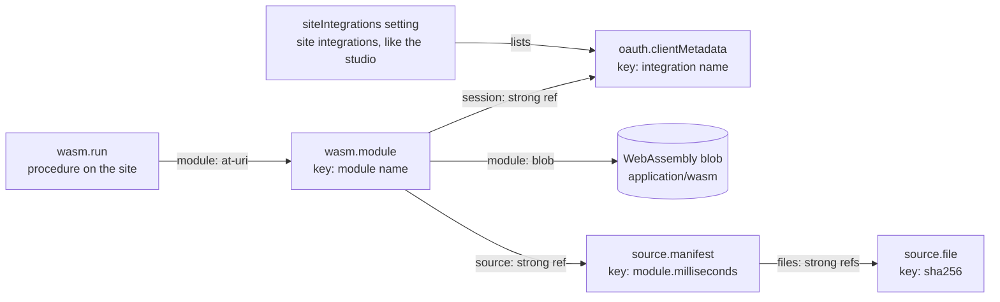

# Lexicons

This project defines five lexicons under `com.fedfork.exec`. Four are record types that live in people's own repos; one is a procedure the site serves. The schemas are in [`lexicons/com/fedfork/exec`](../lexicons/com/fedfork/exec), and the site shows the same reference at [/lexicons](https://exec.fedfork.com/lexicons).

| NSID | Kind | What it is |
| --- | --- | --- |
| [`com.fedfork.exec.oauth.clientMetadata`](#comfedforkexecoauthclientmetadata) | record | An integration: an OAuth client with scope groups |
| [`com.fedfork.exec.wasm.module`](#comfedforkexecwasmmodule) | record | A sandboxed WebAssembly module, its session, actions, allowed calls and source |
| [`com.fedfork.exec.wasm.run`](#comfedforkexecwasmrun) | procedure | Run a module's action for the calling account, with service auth |
| [`com.fedfork.exec.source.manifest`](#comfedforkexecsourcemanifest) | record | An immutable snapshot of a module's source files and build |
| [`com.fedfork.exec.source.file`](#comfedforkexecsourcefile) | record | One source file, keyed by its sha256 |

## How they fit together

Strong references (`com.atproto.repo.strongRef`, a URI and a CID) pin an exact version. A module points at one version of its integration and one manifest; a manifest points at exact file contents. Changing any of them means writing a new record and pointing at it.

## com.fedfork.exec.oauth.clientMetadata

Schema: [`lexicons/com/fedfork/exec/oauth/clientMetadata.json`](../lexicons/com/fedfork/exec/oauth/clientMetadata.json)

An integration: an OAuth client this site can act as, with its full scope and groups of scopes that people grant one at a time.

- **Kind:** record. **Key:** any; the key names the integration, for example `statusphere`.
- **Written by:** the integration's author, into their own repo, with `scripts/publish-records.sh`, the [integration builder](https://exec.fedfork.com/studio/integration), or the [one-click examples](https://exec.fedfork.com/studio/examples).
- **Read by:** the plugin, when it lists integrations, connects one, and serves its client metadata at `/integrations/<did>/<key>/oauth-client-metadata.json`.

How it is used:

- `client_id` and `redirect_uris` are placeholders. The site serves its own, and rebases `client_uri`, `logo_uri`, `tos_uri` and `policy_uri` when they share the placeholder's origin.
- Every scope in a group must also be in `clientMetadata.scope`. Connecting requests `atproto` plus the scopes of the groups a person ticks; ticking more later starts a new authorization for the larger set.
- Only the account that published the record can authorize it, unless the operator lists it as a [site integration](#site-integrations).
- Example: [`records/statusphere.json`](../records/statusphere.json). The studio is [`records/studio.json`](../records/studio.json).

### Fields

#### main (record)

| Field | Required | Type | Constraints and notes |
| --- | --- | --- | --- |
| `name` | yes | `string` | max length 640. max 64 graphemes |
| `description` |  | `string` | max length 3000. max 300 graphemes |
| `clientMetadata` | yes | `#clientMetadata` |  |
| `scopeGroups` |  | `array of #scopeGroup` | at most 64 items. Optional subsets of the declared scope that a user can grant progressively. |
| `createdAt` | yes | `string (datetime)` |  |

#### #clientMetadata

| Field | Required | Type | Constraints and notes |
| --- | --- | --- | --- |
| `client_id` | yes | `string (uri)` |  |
| `client_name` |  | `string` | max length 640 |
| `client_uri` |  | `string (uri)` |  |
| `logo_uri` |  | `string (uri)` |  |
| `tos_uri` |  | `string (uri)` |  |
| `policy_uri` |  | `string (uri)` |  |
| `redirect_uris` | yes | `array of string (uri)` |  |
| `scope` | yes | `string` | max length 20000 |
| `grant_types` |  | `array of string` |  |
| `response_types` |  | `array of string` |  |
| `application_type` |  | `string` |  |
| `token_endpoint_auth_method` |  | `string` |  |
| `dpop_bound_access_tokens` |  | `boolean` |  |

#### #scopeGroup

| Field | Required | Type | Constraints and notes |
| --- | --- | --- | --- |
| `key` | yes | `string` | max length 64 |
| `label` | yes | `string` | max length 640. max 64 graphemes |
| `scopes` | yes | `array of string` | at most 128 items. each item max length 2048 |

## com.fedfork.exec.wasm.module

Schema: [`lexicons/com/fedfork/exec/wasm/module.json`](../lexicons/com/fedfork/exec/wasm/module.json)

A sandboxed WebAssembly module and how to run it.

- **Kind:** record. **Key:** any; the key names the module, and runs refer to `at://<did>/com.fedfork.exec.wasm.module/<key>`.
- **Written by:** the module's author, with `scripts/publish-wasm.sh`, the [module editor](https://exec.fedfork.com/studio/module), or the one-click examples.
- **Read by:** the plugin, to show a module's actions on its integration's card and to run it.

How it is used:

- The plugin downloads `module`, checks its sha256 against the blob's CID, and runs the named entry in an isolate with no imports and no network. The ABI is `emdash-wasm-json-v1`: JSON in, JSON out, with planned XRPC calls that the plugin makes.
- `session` is a strong reference to the integration whose session the module's calls use. Modules only run with a session that the integration record's own account granted.
- `calls` is an allow-list of NSIDs. The plugin refuses any other planned call.
- `source` points at a `com.fedfork.exec.source.manifest`, so anyone can read and rebuild the module.
- Example: [`records/wasm/statusphere.json`](../records/wasm/statusphere.json).

### Fields

#### main (record)

| Field | Required | Type | Constraints and notes |
| --- | --- | --- | --- |
| `name` | yes | `string` | max length 640. max 64 graphemes |
| `description` |  | `string` | max length 3000. max 300 graphemes |
| `module` | yes | `blob` | max size 4 MB. accepts application/wasm |
| `abi` | yes | `string` | known values: emdash-wasm-json-v1. max length 64 |
| `session` | yes | `com.atproto.repo.strongRef` | The com.fedfork.exec.oauth.clientMetadata record whose session the module's calls use. |
| `source` |  | `com.atproto.repo.strongRef` | The com.fedfork.exec.source.manifest record listing the source files and the build that produced the module blob. |
| `actions` | yes | `array of #action` | at most 64 items |
| `calls` |  | `array of string (nsid)` | at most 64 items. NSIDs the module may ask the host to call. The host refuses any other call. When absent, the session's granted scopes are the only limit. |
| `createdAt` | yes | `string (datetime)` |  |

#### #action

| Field | Required | Type | Constraints and notes |
| --- | --- | --- | --- |
| `entry` | yes | `string` | max length 128 |
| `label` | yes | `string` | max length 640. max 64 graphemes |
| `description` |  | `string` | max length 3000. max 300 graphemes |
| `fields` |  | `array of #field` | at most 16 items. String inputs the user supplies; each key becomes a property of the module input. |

#### #field

| Field | Required | Type | Constraints and notes |
| --- | --- | --- | --- |
| `key` | yes | `string` | max length 64 |
| `label` | yes | `string` | max length 640. max 64 graphemes |

## com.fedfork.exec.wasm.run

Schema: [`lexicons/com/fedfork/exec/wasm/run.json`](../lexicons/com/fedfork/exec/wasm/run.json)

The procedure the site serves to run a module for the calling account.

- **Kind:** procedure, at `POST /xrpc/com.fedfork.exec.wasm.run` on the site.
- **Service:** the site is `did:web:<host>`; its document at `/.well-known/did.json` names the service `#emdash_integrations`.

How it is used:

- The caller authenticates with an atproto service-auth JWT: `aud` is the site's `did:web`, `lxm` is `com.fedfork.exec.wasm.run`. The site verifies the signature against the caller's DID document and checks `exp`.
- Each token's `jti` works once. A replay gets `AuthenticationRequired`. Other problems get `InvalidRequest`.
- To call through your PDS, send `atproto-proxy: did:web:<host>#emdash_integrations` with your normal access token; the PDS signs the service-auth token.
- The module must run with a session the calling account connected on the site.

### Fields

#### input

| Field | Required | Type | Constraints and notes |
| --- | --- | --- | --- |
| `module` | yes | `string (at-uri)` | The wasm.module record. |
| `entry` | yes | `string` | max length 64. One of the record's action entries. |
| `input` |  | `unknown` | Action fields, keyed by field key. |

#### output

| Field | Required | Type | Constraints and notes |
| --- | --- | --- | --- |
| `did` | yes | `string (did)` |  |
| `module` | yes | `string` |  |
| `entry` | yes | `string` |  |
| `rounds` | yes | `array of #round` |  |
| `result` |  | `unknown` |  |

#### #round

| Field | Required | Type | Constraints and notes |
| --- | --- | --- | --- |
| `entry` | yes | `string` |  |
| `calls` | yes | `array of #callResult` |  |

#### #callResult

| Field | Required | Type | Constraints and notes |
| --- | --- | --- | --- |
| `nsid` | yes | `string (nsid)` |  |
| `ok` | yes | `boolean` |  |
| `output` |  | `unknown` |  |
| `error` |  | `string` |  |

## com.fedfork.exec.source.manifest

Schema: [`lexicons/com/fedfork/exec/source/manifest.json`](../lexicons/com/fedfork/exec/source/manifest.json)

An immutable snapshot of a module's source and the build that produced its blob.

- **Kind:** record. **Key:** any; the tools use `<module>.<milliseconds>`, so every build keeps its own snapshot.
- **Written by:** `scripts/publish-wasm.sh` for Rust modules and the module editor for AssemblyScript, each time they publish a module. A copy of each published Rust manifest is kept in `records/wasm/<module>.manifest.json`.
- **Read by:** the [source viewer](https://exec.fedfork.com/source) and `scripts/verify-source.sh`, which rebuilds from it in a container and compares hashes.

How it is used:

- `files` lists paths with strong references to `com.fedfork.exec.source.file` records.
- `build` records the tool (`cargo` or `asc`), the compiler version, the command run in the working directory, and the artifact path.
- `output` is the sha256 and size of what the build produced. It must equal the module's blob.
- A manifest is never updated. A new build writes a new manifest, and the module record points at it.

### Fields

#### main (record)

| Field | Required | Type | Constraints and notes |
| --- | --- | --- | --- |
| `name` | yes | `string` | max length 640. max 64 graphemes |
| `description` |  | `string` | max length 3000. max 300 graphemes |
| `language` | yes | `string` | known values: assemblyscript, rust. max length 64 |
| `files` | yes | `array of #entry` | at least 1 items. at most 200 items |
| `build` | yes | `#build` |  |
| `output` |  | `#output` |  |
| `origin` |  | `#origin` |  |
| `createdAt` | yes | `string (datetime)` |  |

#### #entry

| Field | Required | Type | Constraints and notes |
| --- | --- | --- | --- |
| `path` | yes | `string` | max length 512. Path relative to the build's working directory, with forward slashes and no '..' segments. |
| `file` | yes | `com.atproto.repo.strongRef` | The com.fedfork.exec.source.file record holding the contents. |

#### #build

| Field | Required | Type | Constraints and notes |
| --- | --- | --- | --- |
| `tool` | yes | `string` | known values: asc, cargo. max length 64 |
| `version` | yes | `string` | max length 256. The compiler version, for example 'assemblyscript 0.28.20' or 'rustc 1.91.0 (f8297e351 2025-10-28)'. |
| `command` | yes | `string` | max length 2048. The command run in the working directory to produce the module. |
| `artifact` |  | `string` | max length 512. Path of the built module, relative to the working directory. |

#### #output

| Field | Required | Type | Constraints and notes |
| --- | --- | --- | --- |
| `sha256` | yes | `string` | min length 64. max length 64. Lowercase hex sha256 of the module the build produced. |
| `size` | yes | `integer` | minimum 0 |

#### #origin

| Field | Required | Type | Constraints and notes |
| --- | --- | --- | --- |
| `repository` | yes | `string (uri)` | max length 2048 |
| `commit` |  | `string` | max length 64 |

## com.fedfork.exec.source.file

Schema: [`lexicons/com/fedfork/exec/source/file.json`](../lexicons/com/fedfork/exec/source/file.json)

The contents of one source file.

- **Kind:** record. **Key:** the lowercase hex sha256 of the file's bytes, so identical files are stored once, the way git stores blobs. Paths live in the manifests.
- **Written by:** `scripts/publish-wasm.sh` and the studio, before the manifest. An existing file record is reused, never rewritten, so older manifests keep matching.
- **Read by:** the source viewer, `scripts/verify-source.sh`, and anyone rebuilding a module.

How it is used:

- Exactly one of `text` and `blob` is present. Text up to 256 KB is inline; larger or binary files use a blob.
- Readers check that `sha256` matches the record key and the contents, and that the record's CID matches the manifest's strong reference.

### Fields

#### main (record)

| Field | Required | Type | Constraints and notes |
| --- | --- | --- | --- |
| `sha256` | yes | `string` | min length 64. max length 64. Lowercase hex sha256 of the file's bytes. Equal to the record key. |
| `size` | yes | `integer` | minimum 0. Length of the file in bytes. |
| `text` |  | `string` | max length 262144. The file inline, as UTF-8 text. |
| `blob` |  | `blob` | max size 4.8 MB. accepts text/plain, application/octet-stream. The file as a blob, for files too large or not text. |
| `createdAt` | yes | `string (datetime)` |  |

## Site integrations

An `oauth.clientMetadata` record normally connects only the account that published it. The site serves every record's client metadata from its own origin, so letting anyone connect anyone's record would let a stranger put this site's name on a consent screen for their own client.

The operator can vouch for some records instead:

1. Publish the record to the operator's account, for example [`records/studio.json`](../records/studio.json) with `scripts/publish-records.sh`.
2. List its AT-URI, one per line, in the plugin setting `siteIntegrations`: EmDash admin → Plugins → atproto integrations → Settings → Site integrations. Admins can also use the plugin route `admin/site-integrations`. The plugin reads the list from its own settings.
3. Any signed-in account can now connect that record for itself. Each account gets its own session, keyed to the account and the record, with only the scope groups it ticks.

Modules never run with a site integration's session; they only use sessions that their integration record's own account granted.

### The studio is one of these

The studio is not special code. It is a `com.fedfork.exec.oauth.clientMetadata` record with two scope groups:

- **Publish integration records:** `repo:com.fedfork.exec.oauth.clientMetadata`.
- **Publish WebAssembly modules and their source:** `repo:com.fedfork.exec.wasm.module`, `repo:com.fedfork.exec.source.file`, `repo:com.fedfork.exec.source.manifest` and `blob:application/wasm`.

Login asks only for `atproto`. Every extra permission, including the studio's, comes from a new session for a record like this one, granted progressively by scope group. That is the pattern the whole project is built on.
